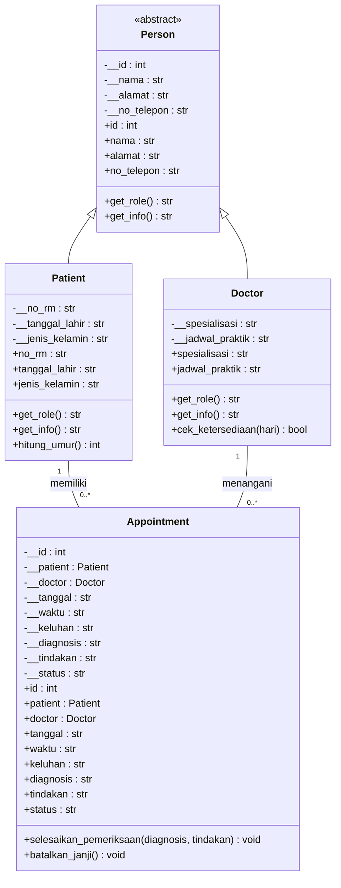
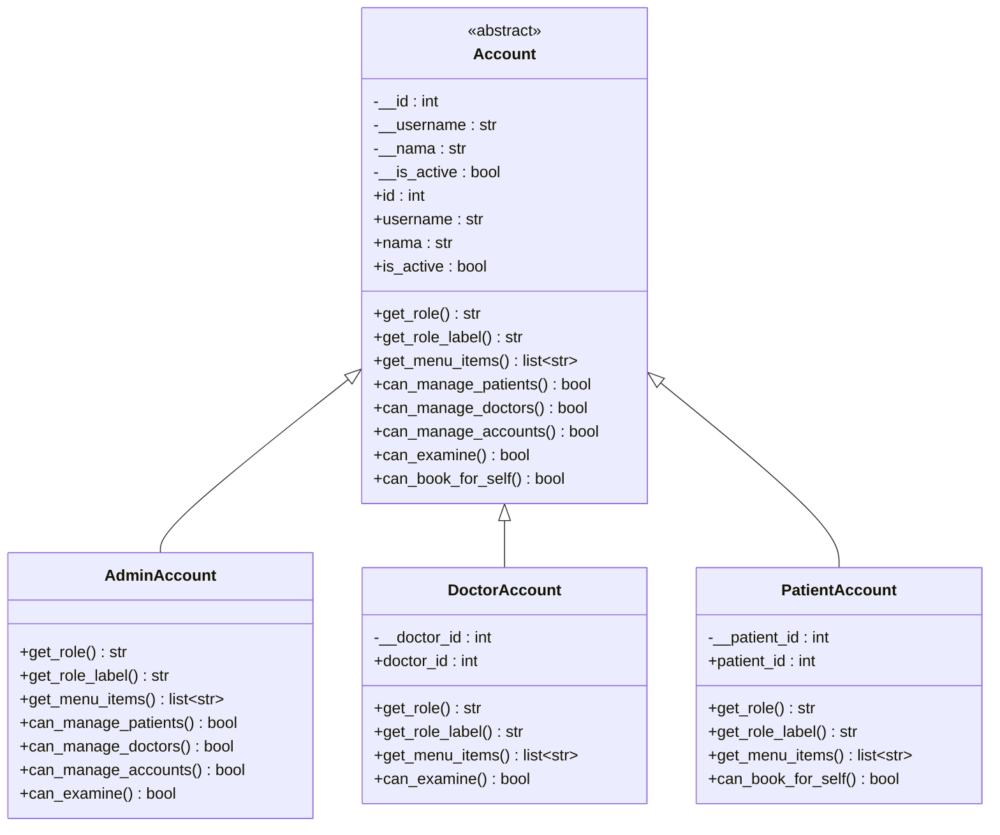
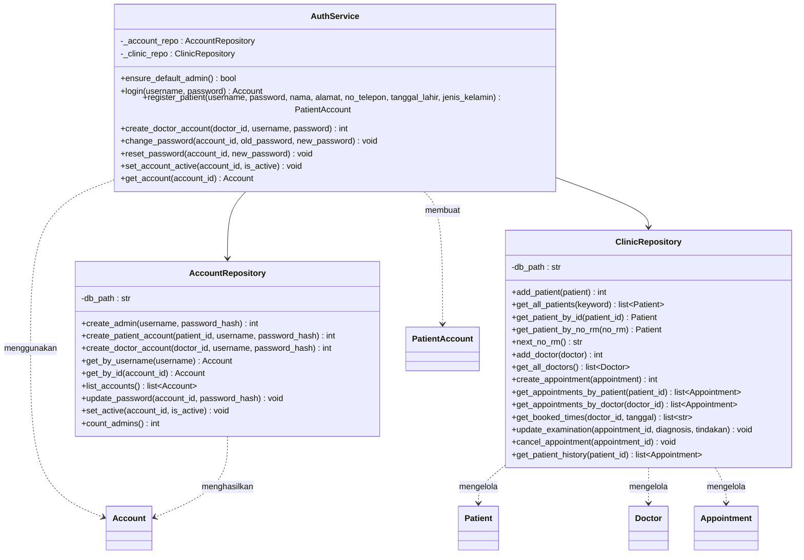
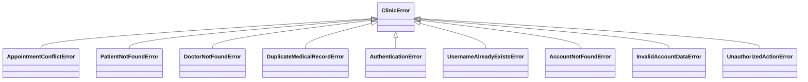
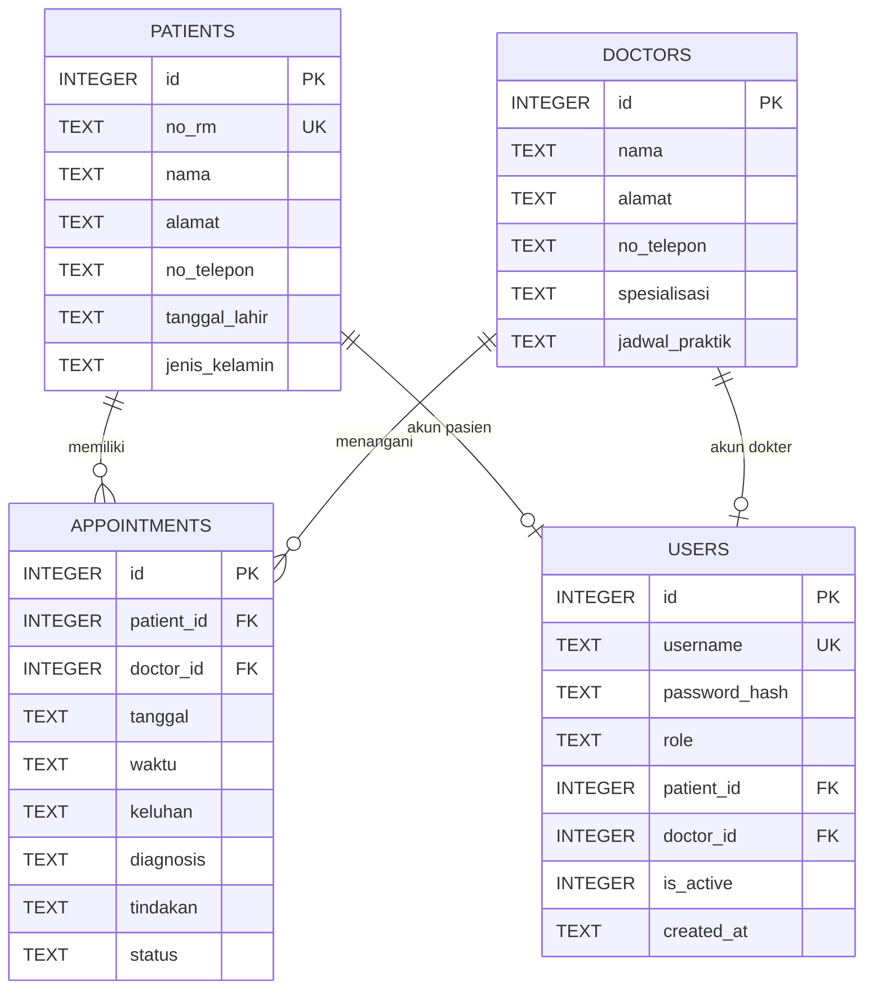
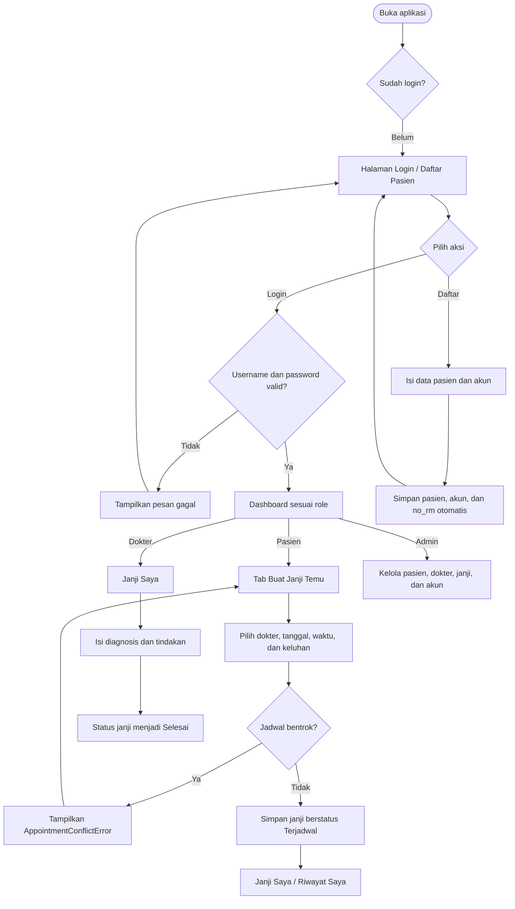

# Diagram UML — Sistem Manajemen Klinik

Dokumen ini berisi diagram UML dalam format **Mermaid**. Diagram dapat
dirender langsung di GitHub, GitLab, atau VS Code dengan ekstensi Mermaid.

Catatan: atribut dengan awalan `__` pada kode Python adalah atribut private
(name mangling). Pada diagram, visibility tetap ditulis sebagai private (`-`).

------------------------------------------------------------------------

## 1. Class Diagram — Model Domain

Keterangan:

- `Person` adalah class abstrak yang menyimpan atribut umum.
- `Patient` dan `Doctor` mewarisi `Person` serta mengimplementasikan ulang
  `get_role()` dan `get_info()`.
- `Appointment` menghubungkan satu pasien dan satu dokter.

------------------------------------------------------------------------

## 2. Class Diagram — Akun dan Hak Akses

Keterangan:

- `Account` adalah class abstrak untuk akun pengguna.
- `AdminAccount`, `DoctorAccount`, dan `PatientAccount` mewarisi `Account`.
- Setiap subclass mengimplementasikan menu dan hak akses yang berbeda
  (polymorphism).
- `DoctorAccount` terhubung ke satu `Doctor`; `PatientAccount` terhubung ke
  satu `Patient`.

------------------------------------------------------------------------

## 3. Class Diagram — Service dan Repository

------------------------------------------------------------------------

## 4. Class Diagram — Custom Exception

------------------------------------------------------------------------

## 5. ER Diagram — Struktur Database

Keterangan:

- Satu pasien dapat memiliki banyak janji; satu dokter dapat menangani
  banyak janji.
- Satu pasien atau dokter memiliki paling banyak satu akun.
- Akun admin tidak terhubung ke `patients` maupun `doctors`.
- `users.username` unik dan `users.password_hash` menyimpan hash password,
  bukan password asli.

------------------------------------------------------------------------

## 6. Activity Diagram — Login, Registrasi, dan Booking Pasien

Diagram ini menggunakan `flowchart` Mermaid sebagai pendekatan activity
diagram.

------------------------------------------------------------------------

## 7. Ringkasan Relasi Antar-Class

| Relasi | Jenis | Keterangan |
|---|---|---|
| `Person` → `Patient` | Inheritance | Pasien mewarisi atribut dan method umum. |
| `Person` → `Doctor` | Inheritance | Dokter mewarisi atribut dan method umum. |
| `Appointment` → `Patient` | Association | Janji dimiliki oleh satu pasien. |
| `Appointment` → `Doctor` | Association | Janji ditangani oleh satu dokter. |
| `Account` → `AdminAccount` | Inheritance | Akun admin. |
| `Account` → `DoctorAccount` | Inheritance | Akun dokter. |
| `Account` → `PatientAccount` | Inheritance | Akun pasien. |
| `AuthService` → `AccountRepository` | Dependency | Layanan auth memakai repository akun. |
| `AuthService` → `ClinicRepository` | Dependency | Registrasi pasien memakai repository klinik. |
| `AccountRepository` → `Account` | Dependency | Repository menghasilkan objek akun. |
| `ClinicRepository` → `Patient` | Dependency | Repository mengelola data pasien. |
| `ClinicRepository` → `Doctor` | Dependency | Repository mengelola data dokter. |
| `ClinicRepository` → `Appointment` | Dependency | Repository mengelola janji. |
| `ClinicError` → exception turunan | Inheritance | Seluruh custom exception mewarisi `ClinicError`. |

------------------------------------------------------------------------

